# PyQuest - Python 기초 퀴즈 게임

PyQuest는 Python 기초 문법과 프로그래밍 핵심 개념을 학습하기 위해 제작된 터미널(콘솔) 기반의 대화형 퀴즈 게임입니다.  
사용자가 직접 퀴즈를 풀고, 새로운 퀴즈를 등록하며, 최고 점수와 퀴즈 데이터가 JSON 파일에 안전하게 보존됩니다.

---

## 1. 프로젝트 개요

- **프로젝트명**: PyQuest (파이썬 기초 퀴즈 게임)
- **개발 유형**: Python 기반 터미널 퀴즈 애플리케이션
- **개발 목적**: 변수, 자료형, 조건문, 반복문, 함수, 클래스, 예외 처리 등 Python 기본 문법을 종합 적용하고, Git/GitHub를 활용한 협업 및 버전 관리 역량을 배양
- **저장소 주소**: https://github.com/haru2014/at02

---

## 2. 퀴즈 주제 및 선정 이유

- **주제**: Python 기초 문법 및 핵심 프로그래밍 용어
- **선정 이유**: 
  1. Python을 처음 학습하는 단계에서 핵심 개념(변수, 자료형, 제어문, 함수, 클래스 등)을 지속적으로 복습하고 체화하기 위함입니다.
  2. 단순 암기를 넘어, 스스로 퀴즈 프로그램을 설계하고 구동하는 과정에서 Python의 실행 메커니즘과 객체지향 구조를 깊이 이해하고자 선정했습니다.

---

## 3. 개발 및 실행 환경

- **언어**: Python 3.14.6 (Python 3.10 이상 권장)
- **운영체제**: Windows 11
- **개발 도구**: Antigravity IDE / VS Code
- **버전 관리**: Git 2.56.0 / GitHub
- **외부 의존성**: 순수 Python 표준 라이브러리만 사용 (`json`, `pathlib` 등 내장 모듈 사용으로 별도 `pip install` 불필요)

---

## 4. 실행 방법 및 동작 흐름

### 4.1 실행 방법
1. 터미널(PowerShell 또는 Bash)을 열고 프로젝트 루트 폴더(`at02`)로 이동합니다.
2. 아래 명령어를 실행합니다:

```powershell
py -3 main.py
```

### 4.2 메인 메뉴 동작 흐름
프로그램 실행 시 `state.json`을 검사하여 기존 데이터를 불러온 후 대화형 메인 메뉴가 표시됩니다:

```text
저장된 데이터 불러오기 완료! 퀴즈 6개

==============================
       PyQuest 퀴즈 게임       
==============================
1. 퀴즈 풀기
2. 퀴즈 추가
3. 퀴즈 목록
4. 점수 확인
5. 종료
==============================
번호를 선택하세요: 
```

- **`1` 입력**: 등록된 전체 문제를 순차 출제하고 100점 만점으로 점수를 환산하여 최고 기록 갱신 여부를 판정합니다.
- **`2` 입력**: 문제 제목, 4개 보기, 정답 번호(1~4)를 차례대로 입력받아 새 퀴즈를 등록하고 파일에 즉시 저장합니다.
- **`3` 입력**: 현재 등록된 모든 퀴즈의 질문 목록을 한눈에 조회합니다.
- **`4` 입력**: 현재까지 달성한 역대 최고 점수와 당시 정답률을 확인합니다.
- **`5` 입력**: 안전하게 데이터를 저장하고 프로그램을 정상 종료합니다.

---

## 5. 주요 기능 및 기본 데이터

### 5.1 주요 기능 목록
1. **퀴즈 풀기**: 저장된 문제들을 순차적으로 풀고 각 문제마다 즉시 정답 여부를 피드백하며, 종료 후 100점 만점 기준 최종 점수를 산출합니다.
2. **퀴즈 추가**: 사용자가 터미널 입력을 통해 새로운 4지선다형 문제를 영구 등록할 수 있습니다.
3. **퀴즈 목록**: 시스템에 보관된 전체 문제 개수와 문제 제목을 번호별로 조회합니다.
4. **점수 확인**: 역대 플레이 중 가장 높았던 최고 점수와 해당 정답 수/전체 문제 수를 표시합니다.
5. **예외 처리 & 안전 종료**: 잘못된 입력(문자열, 빈 값, 범위를 벗어난 번호) 시 재입력을 안내하며, `Ctrl+C`나 `EOF` 인터럽트 발생 시에도 데이터를 보존하고 안전하게 종료합니다.

### 5.2 기본 제공 퀴즈 목록 (초기 5문항)
`state.json` 파일이 없거나 초기화될 때 기본으로 제공되는 5개 문항은 다음과 같습니다:
1. `Python에서 변수에 숫자 10을 저장하는 올바른 코드는?` (정답: `x = 10`)
2. `Python에서 문자열을 나타내는 자료형은?` (정답: `str`)
3. `여러 개의 데이터를 순서대로 저장하는 자료형은?` (정답: `list`)
4. `조건에 따라 다른 코드를 실행하는 키워드는?` (정답: `if`)
5. `Python에서 함수를 정의할 때 사용하는 키워드는?` (정답: `def`)

---

## 6. 객체지향 아키텍처 및 클래스 설계

### 6.1 클래스(OOP) 도입 이유 (함수형 대비 장점)
- 단순 함수 기반 방식에서는 퀴즈 데이터와 점수 변수가 전역(global)으로 관리되어 상태 오염의 위험이 높고, 로직이 비대해질수록 유지보수가 어려워집니다.
- **캡슐화(Encapsulation)**를 통해 개별 문제 데이터와 정답 판정 행위를 하나의 클래스로 묶고, 게임 흐름 제어를 별도 클래스로 분리함으로써 높은 응집도와 낮은 결합도를 실현했습니다.

### 6.2 클래스별 책임과 역할 (SRP: 단일 책임 원칙)
- **`Quiz` 클래스 (데이터 및 개별 엔티티 책임)**:
  - 개별 퀴즈의 상태(질문, 4개 선택지, 정답 번호)를 캡슐화합니다.
  - 사용자가 입력한 번호의 일치 여부를 판정하는 `check_answer(user_answer)` 메서드를 제공합니다.
  - 객체를 딕셔너리로 직렬화하는 `to_dict()` 및 역직렬화하는 `from_dict(data)`를 담당합니다.
- **`QuizGame` 클래스 (비즈니스 로직 및 라이프사이클 제어 책임)**:
  - 퀴즈 목록(`quizzes`) 및 최고 점수(`best_score`, `best_correct`, `best_total`) 상태를 총괄합니다.
  - 메뉴 출력, 퀴즈 플레이 진행, 점수 계산, 문제 추가, 목록 출력 등 유저 인터랙션 흐름을 제어합니다.
  - `state.json` 파일의 로드(`load_state`) 및 저장(`save_state`)을 전담합니다.

### 6.3 입력 검증과 데이터 I/O 분리 기준 (관심사의 분리)
- **입력 검증 (UI/Presentation 계층)**:
  - `play_quiz()`, `add_quiz()` 등 유저 입력 시점에 동작합니다.
  - 문자열 입력, 빈 공백, 1~4 범위를 벗어난 숫자 등 잘못된 입력을 즉시 필터링하여 사용자에게 안내하고 재입력을 유도합니다.
  - **분리 이유**: 오직 유효성 검증을 완벽히 통과한 데이터만 시스템 내부 상태로 전달되도록 방어적 설계를 적용합니다.
- **데이터 I/O (Persistence 계층)**:
  - `load_state()`, `save_state()` 메서드에 집중되어 있습니다.
  - 비즈니스 로직이나 사용자 입력과 완전히 독립되어, 이미 정제된 데이터만을 안전하게 파일 시스템에 기록하거나 불러옵니다.
  - **분리 이유**: 파일 쓰기 중 불완전한 데이터가 유입되는 Partial Write 현상을 원천 방지하며, 저장소가 JSON에서 DB로 변경되더라도 UI 입력 로직을 수정할 필요가 없습니다.

---

## 7. 데이터 영속성 (state.json) 및 저장소 설계

### 7.1 JSON 포맷 채택 이유
1. **가독성 (Human-Readable)**: 사람이 텍스트 에디터로 직접 열어 데이터 구조를 확인하고 수동 검증하기 용이합니다. (`ensure_ascii=False`, `indent=2` 적용)
2. **경량 구조화 (Key-Value & Array)**: Python의 `dict`, `list`와 1:1로 자연스럽게 매핑되어, 무거운 외부 의존성(ORM, 드라이버) 없이 내장 `json` 모듈만으로 직렬화/역직렬화가 가능합니다.

### 7.2 필드별 설계 목적 및 중첩 구조 선택 근거
```json
{
  "quizzes": [
    {
      "question": "Python에서 변수에 숫자 10을 저장하는 올바른 코드는?",
      "options": ["x == 10", "x = 10", "10 = x", "x -> 10"],
      "answer": 2
    }
  ],
  "best_score": 83,
  "best_correct": 5,
  "best_total": 6
}
```

- **`quizzes` (배열)**: 동적으로 추가되는 문제들을 담기 위해 리스트 구조를 선택하였으며, 각 원소는 `question`, `options`, `answer`로 캡슐화된 퀴즈 객체입니다.
- **`best_score` (정수)**: 100점 만점 기준의 최고 점수를 캐싱하여, 프로그램 실행 시 매번 전체 전적을 재계산할 필요 없이 $O(1)$로 즉시 조회할 수 있습니다.
- **`best_correct` & `best_total` (정수)**: 최고 득점 달성 당시의 정답 문항 수와 전체 문제 수를 함께 보관하여, 향후 퀴즈 개수가 추가되더라도 당시의 정확한 정답률을 명확히 보존합니다.
- **중첩 구조 선택 근거**: 가변 길이의 문항 데이터(`quizzes`)와 단일 통계 스칼라 값(`best_*`)의 관심사를 분리 중첩하여 데이터 응집도를 높이고 향후 플레이어 정보나 기록 히스토리 확장을 용이하게 했습니다.

### 7.3 데이터 I/O 라이프사이클 및 저장 시점
- **읽기(Load) 시점**: `QuizGame` 객체 생성자(`__init__`) 실행 시 1회 호출되어 `state.json`을 읽고 메모리에 적재합니다.
- **쓰기(Save) 시점**: 
  1. 새로운 퀴즈 추가 성공 시 즉시 저장
  2. 퀴즈 풀이 후 최고 점수 갱신 시 즉시 저장
  3. 프로그램 정상 종료(메뉴 5번) 및 예기치 못한 인터럽트(`finally` 블록) 시 최종 저장

```text
[프로그램 시작] -> QuizGame.__init__() -> load_state() (state.json 읽기)
      │
      ├─> 퀴즈 추가 완료  ──> save_state() (즉시 저장)
      ├─> 최고 점수 갱신  ──> save_state() (즉시 저장)
      └─> 메뉴 5번 / 종료 ──> save_state() (안전 저장 후 종료)
```

### 7.4 JSON 저장 방식의 한계 및 대안 분석
- **한계점**:
  1. **전체 파일 I/O 부하 ($O(N)$)**: 퀴즈가 1개만 추가되어도 파일 전체를 다시 써야 하므로 데이터가 커질수록 디스크 I/O 비용이 급증합니다.
  2. **메모리 비효율**: 모든 퀴즈 목록을 메모리에 상주시켜야 하므로 대량의 데이터 처리 시 메모리 부담이 발생합니다.
  3. **동시성 및 트랜잭션 부재**: 다중 프로세스/스레드 동시 쓰기 시 파일 락 및 ACID 트랜잭션이 지원되지 않아 파일 손상 위험이 있습니다.
- **확장 대안**:
  - 향후 문항 수가 수천~수만 건으로 확장되거나 다중 사용자 서비스로 발전할 경우, **SQLite** 또는 **PostgreSQL**과 같은 관계형 데이터베이스(RDBMS)를 도입하여 인덱스 기반 부분 조회/갱신 및 트랜잭션 무결성을 보장하도록 개선할 수 있습니다.

### 7.5 백업 및 복구(Recovery) 전략
- **자동 복구 정책**: `state.json` 파일이 손상되었거나(JSONDecodeError) 파일이 누락된 경우, 프로그램이 다운되지 않고 경고 메시지를 출력한 뒤 `questions.py`의 기본 퀴즈 5개와 초기화된 점수로 안전하게 복원합니다.
- **수동 백업 절차**: 중요한 커스텀 퀴즈 데이터가 축적된 경우 `state.json`을 복사하여 `state_backup.json` 또는 날짜별 백업본으로 보관할 수 있습니다.
- **수동 초기화(Factory Reset)**: 초기 상태로 되돌리고자 할 경우 프로젝트 루트의 `state.json`을 삭제하고 프로그램을 재실행하면 기본 5개 퀴즈 상태로 자동 재생성됩니다.

---

## 8. 예외 처리 및 장애 대응 가이드

| 발생 가능한 예외 | 프로그램 대응 방식 | 사용자 조치 방법 |
|---|---|---|
| **메뉴/선택지 입력 오류** | `"숫자를 입력해주세요."`, `"1~5번 중에서 선택하세요."` 안내 후 재입력 | 화면의 안내에 따라 올바른 숫자 범위 입력 |
| **Ctrl+C / EOF 중단** | `KeyboardInterrupt`, `EOFError`를 감지하여 `"입력이 중단되어 안전하게 종료합니다."` 출력 후 상태 저장 | 재실행 시 기존 데이터가 정상 보존됨을 확인 |
| **state.json 파일 없음** | `FileNotFoundError` 발생 시 기본 퀴즈 5개로 즉시 실행 | 별도 조치 불필요 (첫 퀴즈 풀기/추가 시 자동 생성) |
| **state.json 파일 손상** | `json.JSONDecodeError` 발생 시 복구 안내 출력 후 기본 데이터로 복구 | 백업본(`state_backup.json`)이 있다면 파일 내용 교체 |

---

## 9. 프로젝트 파일 구조 및 유지보수 가이드

### 9.1 파일 구조
```text
at02/
├── main.py          # 메인 엔트리포인트, 메뉴 루프 및 안전 종료 처리
├── quiz.py          # Quiz 클래스 정의 (문제, 보기, 정답 판정, 직렬화)
├── questions.py     # 초기 실행용 기본 퀴즈 데이터 정의 (5문항)
├── game.py          # QuizGame 클래스 정의 (게임 진행, 점수 계산, JSON I/O)
├── state.json       # 영속화 데이터 저장 파일 (퀴즈 목록 및 최고 점수)
├── README.md        # 프로젝트 종합 문서 및 결과 보고서
├── .gitignore       # Git 추적 제외 목록 (__pycache__, 가상환경 등)
└── 스샷/            # 미션 수행 및 Git 실습 증빙 스크린샷 (01~39.png)
```

### 9.2 요구사항 변경 시 파일 및 메서드 수정 가이드
향후 기능 확장이나 요구사항 변경 시 수정해야 할 파일과 메서드는 다음과 같습니다:

| 변경 요구사항 | 수정 대상 파일 | 관련 클래스 및 메서드 | 수정 내용 |
|---|---|---|---|
| **새로운 문제 유형 추가**<br>(OX 퀴즈, 단답형 등) | `quiz.py` | `Quiz` 클래스 (또는 하위 상속) | `check_answer()`, `from_dict()`, `to_dict()` 수정 |
| **기본 퀴즈 데이터 변경** | `questions.py` | `DEFAULT_QUESTIONS` 리스트 | 기본 출제할 질문, 선택지, 정답 번호 수정 |
| **점수 산출/배점 방식 변경** | `game.py` | `QuizGame.play_quiz()` | 문제당 배점 로직 및 최고 점수 계산식 수정 |
| **메뉴 기능 추가**<br>(오답 노트, 통계 조회 등) | `main.py`<br>`game.py` | `main.py > main()`<br>`QuizGame` 신규 메서드 | 메뉴 번호 선택 분기 추가 및 신규 동작 메서드 구현 |
| **저장소 변경 (JSON -> DB)** | `game.py` | `QuizGame.load_state()`<br>`QuizGame.save_state()` | 파일 I/O 로직을 DB 연결 및 SQL 쿼리로 대체 |

---

## 10. Git 및 GitHub 관리 전략

### 10.1 커밋 메시지 컨벤션 규칙 (Conventional Commits)
본 프로젝트는 변경 이력을 명확히 추적하기 위해 표준화된 커밋 메시지 규칙을 준수합니다.

- **형식**: `<Type>: <Subject>`
- **커밋 타입(Type)**:
  - `Feat`: 새로운 기능 추가 (예: `Feat: 퀴즈 풀기 기능 구현`)
  - `Fix`: 버그 및 예외 처리 수정 (예: `Fix: 입력 오류와 파일 예외 처리`)
  - `Refactor`: 코드 구조 개선 및 리팩토링 (예: `Refactor: QuizGame 클래스 구조 정리`)
  - `Docs`: 문서 수정 및 추가 (예: `Docs: README 프로젝트 설명 작성`)
  - `Chore`: 빌드, 패키지 및 환경 설정 (예: `Chore: 프로젝트 초기 설정`)
  - `Merge`: 브랜치 병합 (예: `Merge: 퀴즈 풀기 기능 병합`)
- **작성 규칙**:
  1. 제목은 50자 이내의 명확한 한글 명령형 요약으로 작성합니다.
  2. 상세 내역이 필요한 경우 본문에 변경 이유와 상세 항목을 불릿(`-`)으로 기재합니다.

### 10.2 브랜치 전략 (Git Flow 기반)
- `main`: 항시 배포 가능한 안정적인 프로덕션 브랜치
- `feature/*`: 단위 기능 개발을 위한 독립 브랜치 (예: `feature/quiz-play`)
- **병합 규칙**: 기능 개발 완료 후 `main` 브랜치로 병합할 때, 브랜치의 생성과 병합 히스토리를 분명하게 보존하기 위해 Fast-Forward를 지양하고 **`git merge --no-ff`** 방식을 적용합니다.

---

## 11. Git clone 및 pull 실습

GitHub 원격 저장소와의 완벽한 동기화를 검증하기 위해 다음 실습을 완료했습니다:
1. 별도 디렉터리(`at02_clone`)에 원격 저장소를 `git clone`으로 복제
2. 복제본에서 README를 수정하고 `git commit` 및 `git push origin main` 수행
3. 원본 작업 디렉터리(`at02`)에서 `git pull origin main`을 실행하여 원격 변경사항을 성공적으로 동기화

---

## 12. 미션 수행 결과 보고서 및 증빙

기획서의 목표 및 완료 기준에 따른 단계별 기능 구현과 검증 결과입니다.

### 12.1 개발 환경 구성 및 버전 확인
- **내용**: Python 3.14.6 및 Git 2.56.0 환경 설정 확인
- **증빙 화면**:
  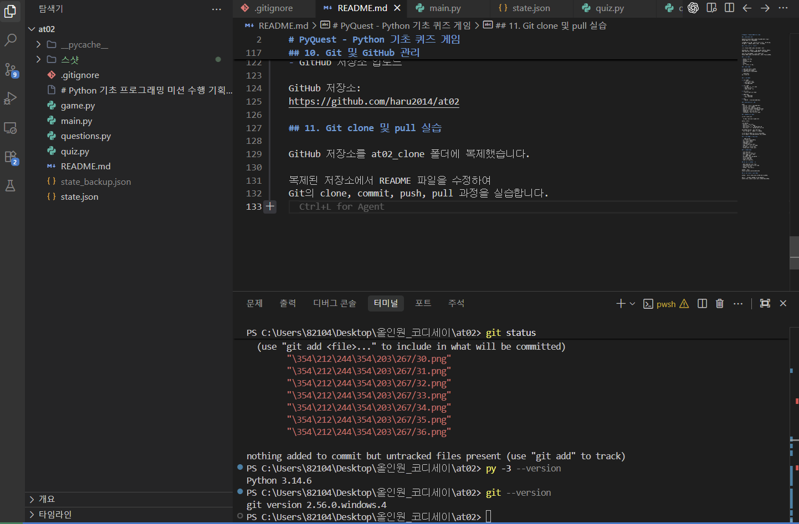
  *(캡션: `py -3 --version`으로 Python 3.14.6 확인 및 `git --version`으로 Git 2.56.0 확인)*

---

### 12.2 주요 기능 구현 및 테스트 결과

#### (1) 퀴즈 풀기 및 채점
- **내용**: 기본 제공 퀴즈 5문항 출제, 정답 판정 및 최종 점수(100점) 정상 산출
- **증빙 화면**:
  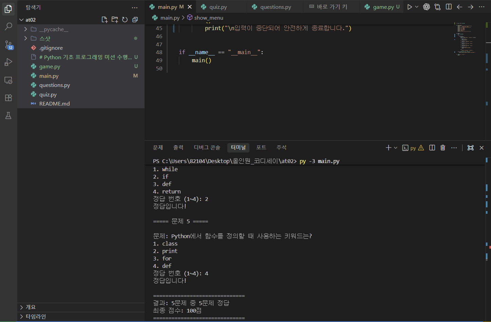
  *(캡션: 퀴즈 풀기 기능 실행 - 5문항 모두 정답 판정 및 100점 만점 출력)*

#### (2) 퀴즈 추가 기능
- **내용**: 문제 내용, 4개 선택지, 정답 번호를 직접 입력하여 새로운 퀴즈(6번째 문항) 등록
- **증빙 화면**:
  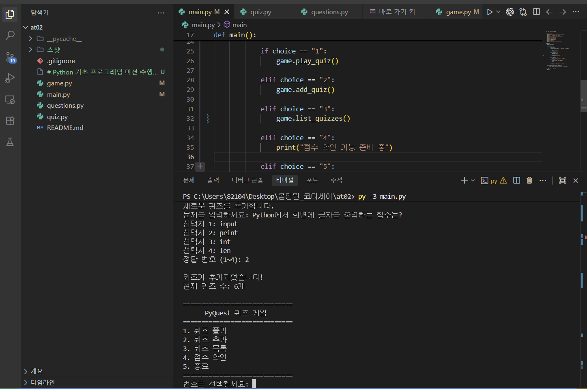
  *(캡션: 새로운 퀴즈 추가 메뉴 실행 - 6번째 문제 정상 등록 및 퀴즈 수 증가 확인)*

#### (3) 퀴즈 목록 조회 기능
- **내용**: 등록된 전체 퀴즈 6문항 목록 정상 조회 확인
- **증빙 화면**:
  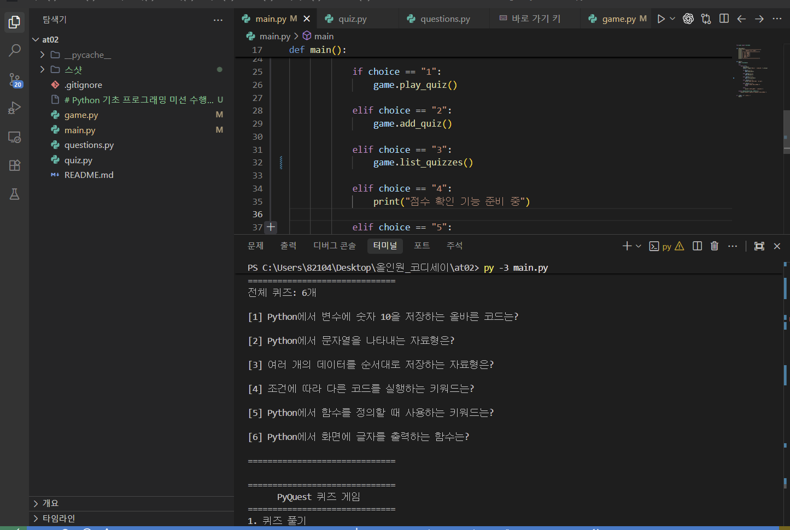
  *(캡션: 퀴즈 목록 메뉴 실행 - 기존 5문제 + 새로 추가된 1문제 총 6문제 목록 출력)*

#### (4) 최고 점수 확인 기능
- **내용**: 이전 플레이 기록의 최고 점수(83점) 및 정답 수(6문제 중 5문제) 확인
- **증빙 화면**:
  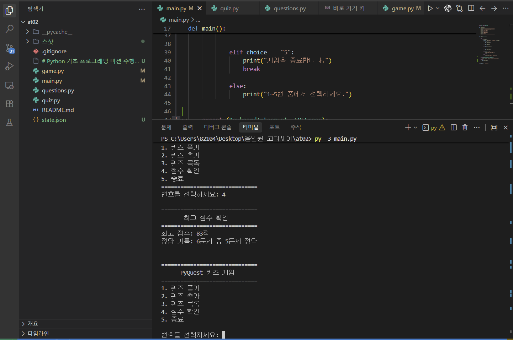
  *(캡션: 점수 확인 메뉴 실행 - 최고 점수 83점 및 6문제 중 5문제 정답 기록 출력)*

---

### 12.3 데이터 영속성 및 예외 처리 검증

#### (1) JSON 데이터 파일(`state.json`) 저장 및 불러오기
- **내용**: 프로그램 재실행 시 기존에 추가된 퀴즈와 최고 점수 데이터가 정상 복원됨을 확인
- **증빙 화면**:
  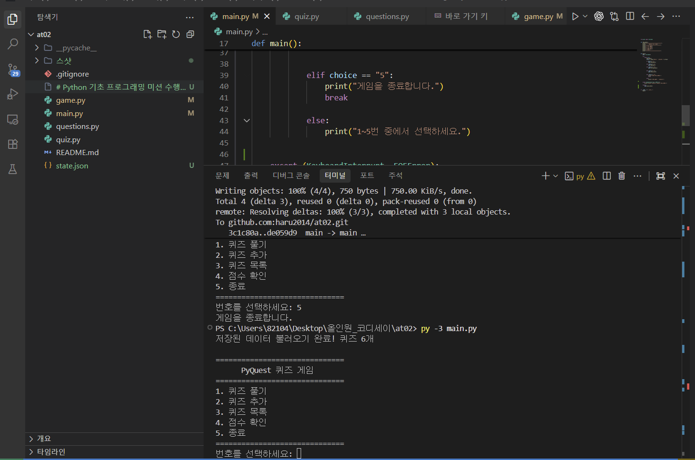
  *(캡션: 프로그램 재실행 시 '저장된 데이터 불러오기 완료! 퀴즈 6개' 로그 출력 확인)*

#### (2) 입력 오류 방지 및 예외 처리
- **내용**: 문자열 입력(`abc`), 범위 밖 숫자(`0`, `9`), 빈 입력 예외 처리 및 Ctrl+C 중단 시 안전 종료
- **증빙 화면**:
  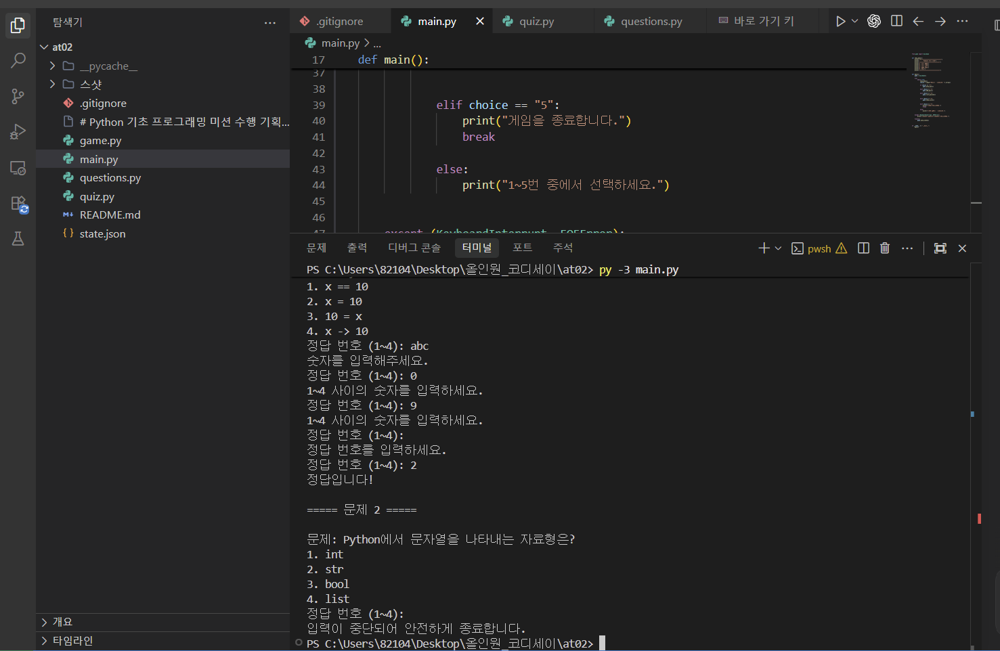
  *(캡션: 비정상 입력 방어 및 KeyboardInterrupt 인터럽트 시 안전 종료 메시지 출력)*

---

### 12.4 Git 형상 관리 및 브랜치 실습

#### (1) 브랜치 생성 및 병합 (`feature/quiz-play`)
- **내용**: `feature/quiz-play` 브랜치를 생성하여 퀴즈 풀기 기능을 개발한 뒤, `git merge --no-ff`로 병합 이력 보존
- **증빙 화면**:
  
  *(캡션: `git merge --no-ff feature/quiz-play` 병합 실행 및 커밋 그래프 확인)*

#### (2) 커밋 이력 및 관리 (10회 이상 기능 단위 커밋)
- **내용**: 기획서 요구 기준(10회 이상)을 초과 달성한 커밋 및 브랜치 병합 그래프 이력 확인
- **증빙 화면**:
  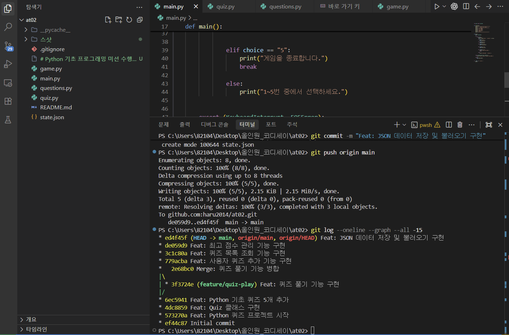
  *(캡션: `git log --oneline --graph --all` 실행을 통한 10개 이상의 기능 단위 커밋 이력 확인)*

#### (3) 문서화(README) 커밋 및 GitHub Push
- **내용**: 프로젝트 설명 및 실행 방법 작성 후 GitHub 원격 저장소(`haru2014/at02`)에 Push
- **증빙 화면**:
  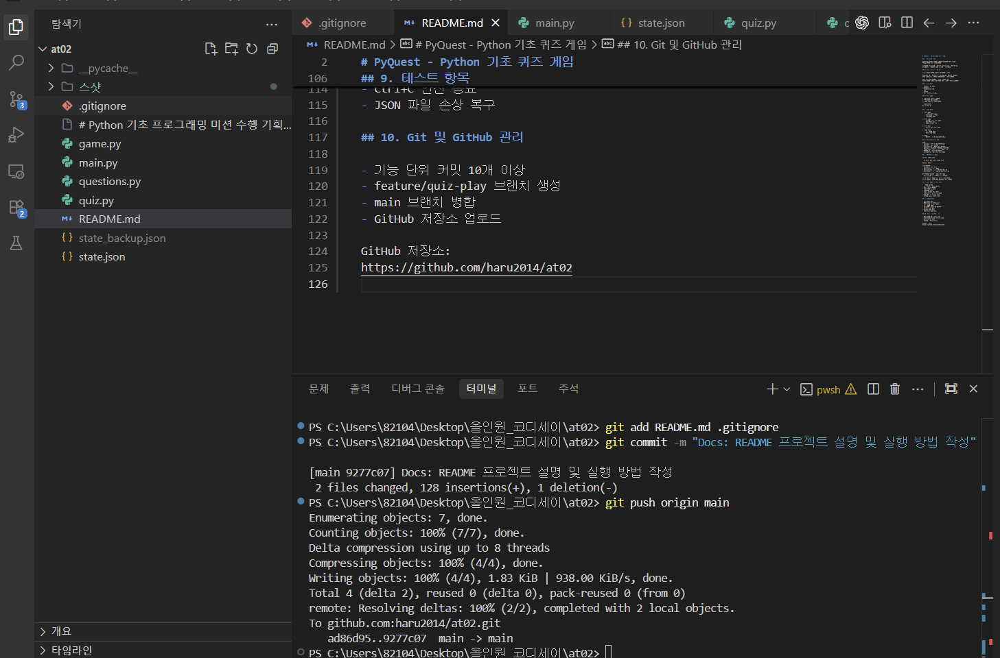
  *(캡션: README.md 커밋 및 원격 GitHub 저장소 main 브랜치로 push 완료)*

---

### 12.5 원격 저장소 복제(Clone) 및 동기화(Push / Pull) 실습

#### (1) 원격 저장소 복제 (Clone)
- **내용**: 별도 폴더(`at02_clone`)에 GitHub 원격 저장소를 `git clone`하여 복제 확인
- **증빙 화면**:
  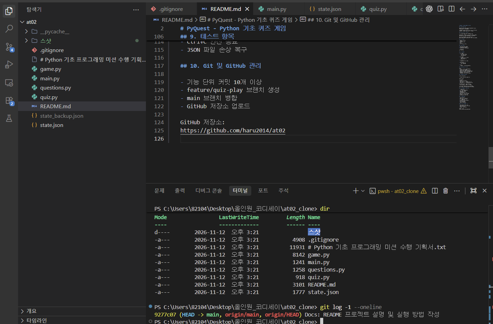
  *(캡션: `at02_clone` 디렉터리에서 `dir` 및 `git log`를 통한 clone 성공 확인)*

#### (2) 복제본 수정 및 원격 반영 (Commit & Push)
- **내용**: `at02_clone` 디렉터리에서 README 수정 후 커밋 및 GitHub 원격 저장소에 Push
- **증빙 화면**:
  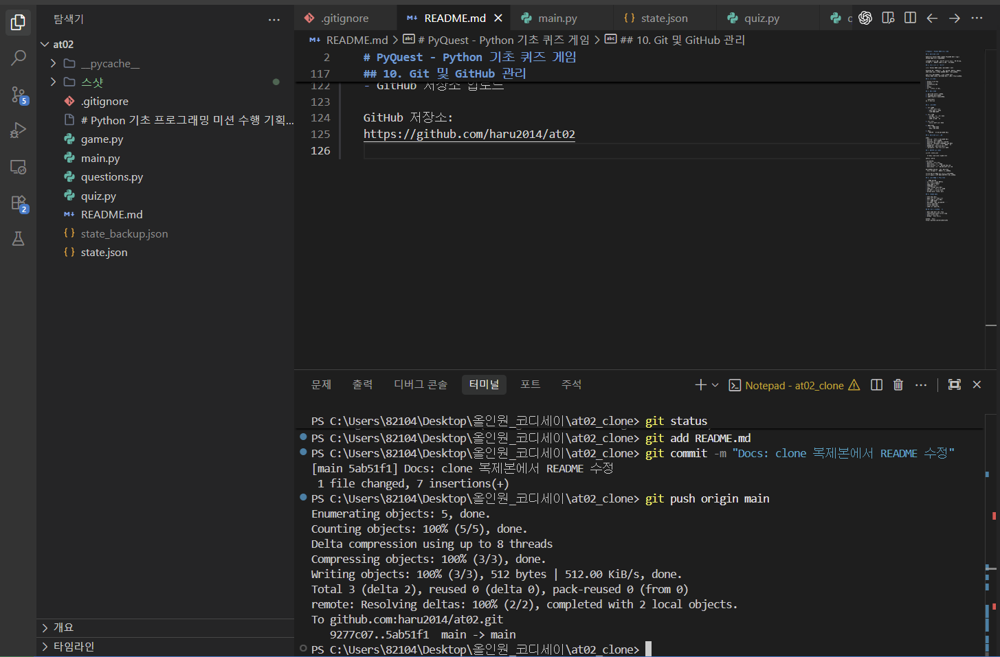
  *(캡션: 복제 저장소에서 수정 사항 커밋 및 `git push origin main` 실행)*

#### (3) 원본 저장소 최신화 (Pull)
- **내용**: 원본 작업 디렉터리(`at02`)에서 `git pull origin main`을 실행하여 원격 변경사항을 성공적으로 동기화
- **증빙 화면**:
  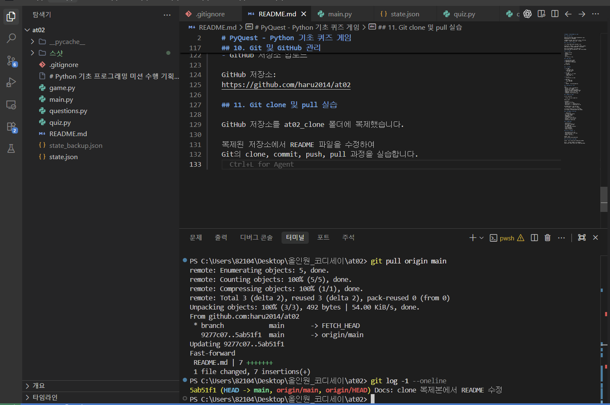
  *(캡션: 원본 저장소에서 `git pull origin main` 실행 및 최신 커밋 반영 확인)*

---

### 12.6 최종 요구사항 달성 검증표

| 평가 항목 | 요구 기준 | 달성 여부 | 증빙 및 반영 위치 |
|---|---|:---:|:---:|
| **개발 환경 설정** | Python 3.10+ 및 Git 설치 확인 | **완료** | 섹션 3, `스샷/39.png` |
| **객체지향 설계** | `Quiz`, `QuizGame` 클래스 책임 분리 | **완료** | 섹션 6, 소스코드 (`quiz.py`, `game.py`) |
| **설계 근거 문서화** | 클래스 도입 이유 및 함수 대비 차이 | **완료** | 섹션 6.1 |
| **로직 분리 기준** | 입력 검증 vs 데이터 I/O 분리 기준 | **완료** | 섹션 6.3 |
| **퀴즈 풀기 기능** | 문제 출제 및 정답/점수 산출 | **완료** | 섹션 5.1, `스샷/10.png` |
| **퀴즈 추가 기능** | 4지선다형 사용자 퀴즈 등록 | **완료** | 섹션 5.1, `스샷/17.png` |
| **퀴즈 목록 조회** | 전체 퀴즈 목록 표시 | **완료** | 섹션 5.1, `스샷/18.png` |
| **최고 점수 관리** | 최고 기록 유지 및 점수 확인 | **완료** | 섹션 5.1, `스샷/28.png` |
| **JSON 채택 근거** | 가독성 및 계층 구조화 장점 설명 | **완료** | 섹션 7.1 |
| **JSON 필드 설계** | 필드별 목적 및 중첩 구조 근거 | **완료** | 섹션 7.2 |
| **데이터 영속화** | `state.json` 저장 및 재실행 시 복원 | **완료** | 섹션 7.3, `스샷/26.png` |
| **JSON 한계 분석** | 규모 증가 시 한계 및 DB 대안 제시 | **완료** | 섹션 7.4 |
| **백업 및 복구 전략** | 자동 복구, 수동 백업 및 초기화 절차 | **완료** | 섹션 7.5 |
| **예외 처리** | 입력 오류 처리 및 Ctrl+C 안전 종료 | **완료** | 섹션 8, `스샷/30.png` |
| **유지보수 가이드** | 요구사항 변경 시 파일/메서드 목록화 | **완료** | 섹션 9.2 |
| **커밋 컨벤션** | 커밋 메시지 규칙 및 프리픽스 정의 | **완료** | 섹션 10.1 |
| **브랜치 실습** | `feature/quiz-play` 브랜치 병합 | **완료** | 섹션 10.2, `스샷/11_2e68bc0...png` |
| **커밋 이력** | 기능 단위 커밋 10회 이상 달성 | **완료** | 섹션 10.1, `스샷/29.png` |
| **원격 저장소 배포** | GitHub 저장소 커밋 & 푸시 | **완료** | 섹션 1, `스샷/33.png` |
| **Clone & Pull 실습** | 별도 폴더 복제 및 Pull 동기화 | **완료** | 섹션 11, `스샷/34~36.png` |
